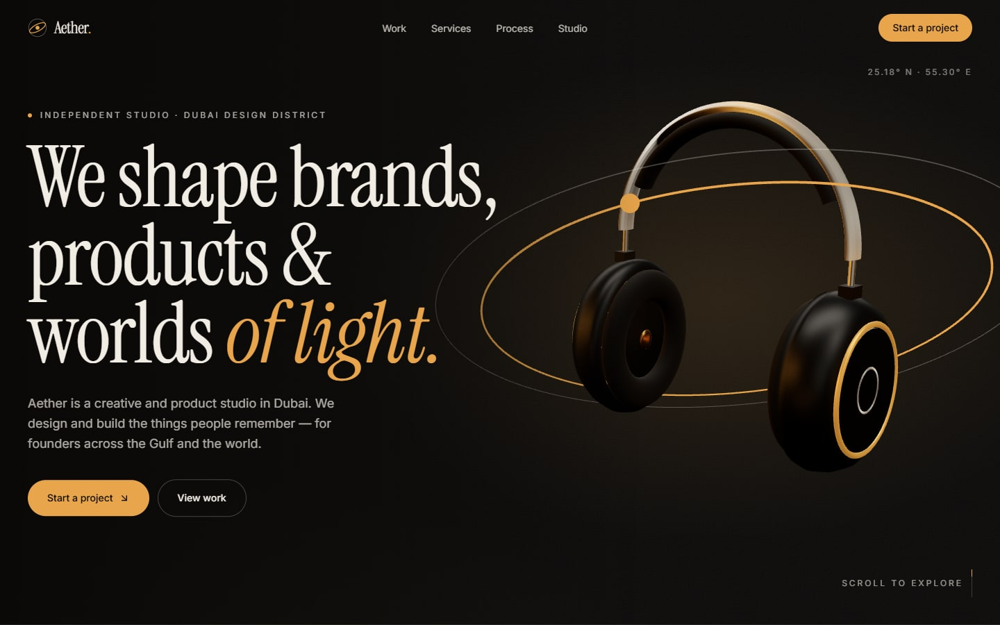
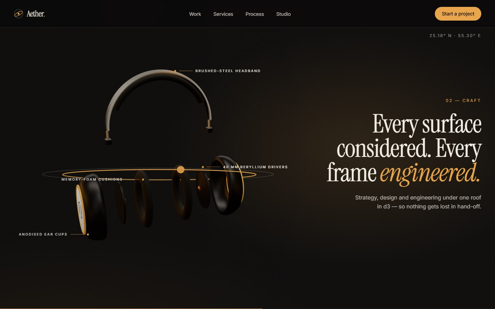
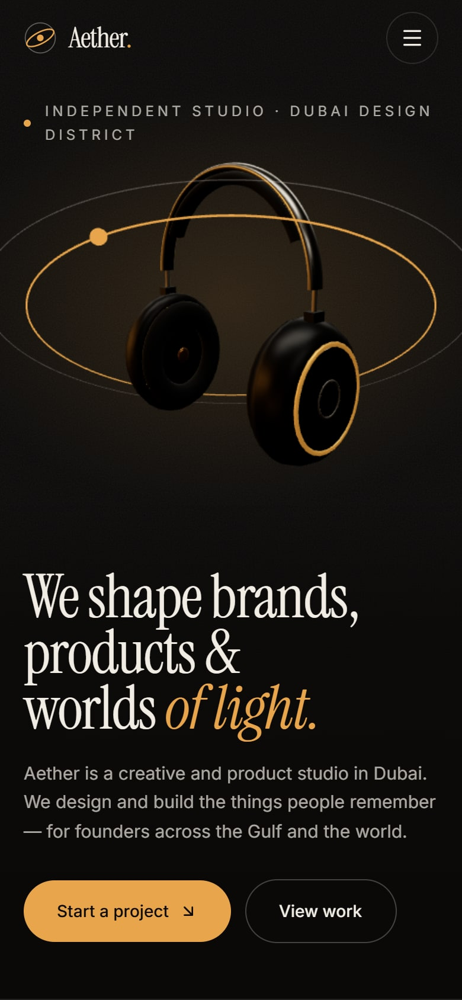

# Aether Studio

A cinematic, scroll-driven website for Aether — a fictional creative and product studio headquartered in Dubai Design District. A pair of premium over-ear headphones carries the story: it turns slowly as you scroll, opens into an exploded view of its parts, then reassembles and settles.

**Live:** [studio.ahmadkhajeh.com](https://studio.ahmadkhajeh.com)

Demo project by Ahmad Khajeh — [ahmadkhajeh.com](https://ahmadkhajeh.com)



## Highlights

- **Scroll-driven 3D hero** — real-time React Three Fiber headphones, modelled entirely in code, with a brushed-steel band, matte cups, amber accent rings and studio reflections. Scroll choreographs a slow three-quarter turn, an exploded view and a final settle across three pinned, crossfading chapters.
- **Exploded view with callouts** — ear cups, cushions, drivers and headband separate along their axes, each tracked by a thin amber label.
- **A studio rooted in Dubai** — d3 headquarters, a DIFC client lounge, Gulf and global case studies, live Dubai time and pricing in AED with USD equivalents.
- **Pinned horizontal work gallery** — six case studies glide sideways with image parallax, collapsing into a simple grid on phones.
- **Buttery smooth scrolling** — Lenis and GSAP ScrollTrigger share a single ticker, so every animation stays in sync.
- **Performance first** — a pre-rendered still paints instantly while the 3D scene loads in the background, then adapts its resolution to the device, pauses off-screen and runs a lighter scene on mobile.
- **Respectful motion** — with reduced motion enabled, the site shows a still render of the headphones and uses native scrolling.
- **Accessible and searchable** — keyboard-friendly navigation with visible focus, semantic landmarks, structured data, Open Graph images, sitemap and robots.
- **Validated contact flow** — a typed form with inline errors, budget ranges in AED and a polished success state.



<p align="center">
  
</p>

## Tech stack

- [Next.js](https://nextjs.org) (App Router) and TypeScript
- [Tailwind CSS v4](https://tailwindcss.com) and [shadcn/ui](https://ui.shadcn.com)
- [React Three Fiber](https://r3f.docs.pmnd.rs), [drei](https://drei.docs.pmnd.rs) and [three.js](https://threejs.org)
- [GSAP ScrollTrigger](https://gsap.com/docs/v3/Plugins/ScrollTrigger/) and [Lenis](https://lenis.darkroom.engineering)
- [React Hook Form](https://react-hook-form.com) and [Zod](https://zod.dev)

## Run locally

```bash
npm install
npm run dev
```

Then open [http://localhost:3000](http://localhost:3000).
